\newpage

# Course and group information

| | |
| --- | --- |
| University / Faculty | Ho Chi Minh City University of Technology (HCMUT), VNU-HCM — Faculty of Computer Science and Engineering |
| Course | Machine Learning, [Course code, e.g. CO3117] |
| Semester | Semester I, Academic Year 2026–2027 |
| Instructor | [Instructor full name and title] ([instructor email]) |
| Topic | Task 2 — Machine Learning with Text Data, including the bonus deep-learning pipeline |
| Colab notebook | `notebooks/text_classification_colab.ipynb` ([open in Colab](https://colab.research.google.com/github/NickCT1612yuri/text-classification-ml-assignment/blob/main/notebooks/text_classification_colab.ipynb)) |
| Source repository | [https://github.com/NickCT1612yuri/text-classification-ml-assignment](https://github.com/NickCT1612yuri/text-classification-ml-assignment) |
| Extracted features | `features/` (`.npy`, `.npz`, `.h5`) |

| Full name | Student ID | Email |
| --- | --- | --- |
| [Member 1 full name] | [Student ID] | [member1@hcmut.edu.vn] |
| [Member 2 full name] | [Student ID] | [member2@hcmut.edu.vn] |

Individual contribution percentages are reported in Section~10 (Work distribution).

# Abstract

This report presents a complete traditional machine learning pipeline for text classification, together with a bonus deep-learning comparison, as required by Task~2 of the Machine Learning course assignment. Three publicly available datasets are studied under a common experimental protocol: AG~News (topic classification), Rotten Tomatoes (sentence-level sentiment), and Banking77 (fine-grained banking intent). Configurable preprocessing (stop-word removal, tokenization, padding, and optional negation marking) is combined with five feature families—Bag-of-Words, TF-IDF, Word2Vec, DistilBERT, and BGE-small—whose embeddings are persisted as `.npy` / `.h5` files and classified with Naive Bayes, logistic regression, calibrated linear SVM, and XGBoost. A bonus 3$\times$3 deep-learning grid (BiLSTM, TextCNN, SetFit $\times$ Word2Vec, DistilBERT, BGE) is evaluated against the classical pipeline.

Empirically, lexical TF-IDF models remain competitive on topic classification (within approximately 1.5 Macro-F1 points of the best Transformer pipeline). On sentiment and intent, contrastively pretrained BGE embeddings yield the strongest results (83.77 Macro-F1 with BGE + XGBoost on Rotten Tomatoes; 92.38 with BGE + LinearSVC on Banking77), whereas a frozen masked-language DistilBERT encoder under a linear head does not outperform TF-IDF on those tasks. Preprocessing effects match theoretical expectations: stop-word removal harms sentiment and intent; negation marking improves Word2Vec + BiLSTM by +2.3 / +2.5 Macro-F1 on Rotten Tomatoes / Banking77. Calibration metrics further show that accuracy and probability quality are distinct evaluation axes. The study illustrates when course concepts—independence assumptions, margin classifiers, static versus contextual embeddings, and sequence models—succeed or fail under realistic text regimes.

# Introduction

## Motivation and assignment alignment

The Machine Learning course assignment requires students to apply theoretical knowledge to a full pipeline: exploratory data analysis (EDA), preprocessing, feature extraction, model training, and evaluation. Task~2 focuses on text data and mandates (i) a traditional pipeline with configurable preprocessing and classifiers, (ii) at least two feature extractors spanning lexical and modern embedding approaches, with embeddings saved as `.npy` or `.h5`, and (iii) an EDA report plus a comparison of traditional and modern methods. An optional deep-learning pipeline earns bonus credit when compared against the traditional path.

Text classification is a suitable testbed for these requirements because the same learning problem admits both sparse lexical features (Bag-of-Words, TF-IDF) taught in classical machine learning and dense representations (Word2Vec, Transformers) associated with modern neural methods. Whether the more expensive representation is justified depends on the inductive bias of the task: keyword-driven topics versus compositional polarity or fine-grained intents.

## Research questions

This report organises experiments around four questions that connect course concepts to empirical evidence:

1. **When do lexical features suffice?** Under which task regimes does TF-IDF with a linear classifier approach frozen Transformer embeddings?
2. **How does pretraining objective affect frozen embeddings?** Does a contrastive sentence encoder (BGE) separate classes more linearly than a masked-language model (DistilBERT) used without fine-tuning?
3. **How should preprocessing interact with representation?** Do stop-word removal, subword tokenization, padding/masking, and negation marking affect sparse models, static Word2Vec sequence models, and frozen Transformers differently?
4. **What do bonus sequence and few-shot models add?** Relative to mean-pooled embeddings and full-label linear heads, how do BiLSTM / TextCNN (static or frozen-token) and SetFit few-shot adaptation perform?

## Contributions of this work

- A configurable traditional pipeline covering EDA, Boolean preprocessing, five embedding families, four classical classifier families, and calibrated evaluation (accuracy, Macro-F1, Brier score, ECE).
- A controlled comparison across three deliberately dissimilar datasets at matched training scale (about 8.5--10k documents).
- A bonus deep-learning grid that separates static Word2Vec sequence modelling, frozen Transformer token states with sequence heads, and few-shot SetFit.
- Analysis that links observed gains and failures to the independence assumption of Naive Bayes, margin-based linear classification, static versus contextual embeddings, and calibration.

# Theoretical background

This section summarises the course-relevant ideas used in the pipeline. Formal derivations are omitted; the emphasis is on inductive biases that later interpret the results.

## Lexical representations

**Bag-of-Words (BoW)** maps a document to counts (or binary indicators) over a vocabulary, discarding order. **TF-IDF** reweights terms by inverse document frequency so that rare, discriminative words receive higher weight. **$n$-grams** (here, unigrams and bigrams) partially recover local order (*not funny*, *top up*). These features are sparse, interpretable, and effective when class labels correlate with the presence of specific words—as is typical in news topic classification.

## Classical classifiers

**Multinomial Naive Bayes** models $P(x \mid y)$ under a conditional independence assumption over features. On sparse word counts this assumption is often useful; on dense, highly correlated embedding dimensions, Gaussian Naive Bayes tends to over-count evidence and produce overconfident posteriors.

**Logistic regression** and the **linear SVM** are discriminative models. Logistic regression estimates $P(y \mid x)$ via a linear (or one-vs-rest) decision boundary; the linear SVM maximises margin. Both assume that classes are approximately linearly separable in feature space. **XGBoost** builds an additive ensemble of trees and can capture nonlinear interactions among dense coordinates, at higher computational cost—especially on sparse high-dimensional BoW/TF-IDF inputs.

## Static and contextual embeddings

**Word2Vec** (skip-gram) learns fixed word vectors from local co-occurrence. Averaging word vectors yields a document embedding that ignores order; feeding the sequence into a BiLSTM or TextCNN restores order or local patterns while still relying on corpus-trained static geometry.

**DistilBERT** is pretrained with a masked language modelling (MLM) objective: predict masked tokens from context. Mean-pooling its token states produces a document vector, but MLM does not explicitly optimise sentence-level similarity.

**BGE-small** is a compact encoder further trained with contrastive objectives so that semantically related sentences lie close in embedding space. A linear classifier on frozen BGE vectors therefore tests whether the representation already organises classes for downstream separation.

## Sequence models and few-shot adaptation

A **bidirectional LSTM** summarises left-to-right and right-to-left context; a **TextCNN** applies multi-width convolutions over the embedding sequence (Kim, 2014), detecting local $n$-gram patterns efficiently. **SetFit** adapts a sentence encoder with contrastive pairs from few labelled examples per class, then fits a logistic head—useful when labels are scarce, but sensitive to the number of classes.

## Evaluation metrics

**Accuracy** treats all examples equally. **Macro-averaged F1** averages per-class F1 and is appropriate for Banking77, where intents are imbalanced. **Brier score** and **expected calibration error (ECE)** assess whether predicted probabilities match empirical frequencies—important whenever confidence informs decisions.

# Datasets and exploratory data analysis

## Datasets

All corpora are downloaded from public Hugging Face identifiers inside the notebook; no personal cloud drive is mounted.

| Dataset | Hugging Face id | Task | Classes | Train / test used |
| ---------- | ------------------------------------------ | -------------------- | ------: | -------------------- |
| AG News | `fancyzhx/ag_news` | news topic (World, Sports, Business, Sci/Tech) | 4 | 10,000 / 2,000 (stratified sample of the official 120,000 / 7,600 split) |
| Rotten Tomatoes | `cornell-movie-review-data/rotten_tomatoes` | critic-sentence sentiment (neg / pos) | 2 | 8,530 / 1,066 (official train / test) |
| Banking77 | `mteb/banking77` | online-banking customer intent | 77 | 9,993 / 3,076 (official train / test) |

AG News is stratified-subsampled (seed 42) so that training sizes are comparable across datasets. Test splits are never used for vocabulary fitting, PCA, early stopping, or model selection.

## Descriptive statistics

Word counts use normalised text (lower case; HTML and URLs removed) and whitespace tokenization.

| Statistic | AG News | Rotten Tomatoes | Banking77 |
| ---------------------------------- | -----------------: | -----------------: | -----------------: |
| training / test documents | 10,000 / 2,000 | 8,530 / 1,066 | 9,993 / 3,076 |
| documents per class (min / max) | 2,500 / 2,500 | 4,265 / 4,265 | 35 / 187 |
| words per document: mean (std) | 37.98 (10.38) | 20.99 (9.37) | 11.96 (7.89) |
| median / 95th pct / 99th pct / max | 37 / 53 / 72 / 140 | 20 / 37 / 45 / 59 | 10 / 29.4 / 43 / 79 |
| vocabulary with / without stop words | 24,406 / 24,121 | 16,917 / 16,629 | 2,353 / 2,128 |
| share of tokens that are stop words | 35.6% | 46.8% | 60.7% |
| documents containing a negation | 11.2% | 21.6% | 25.5% |

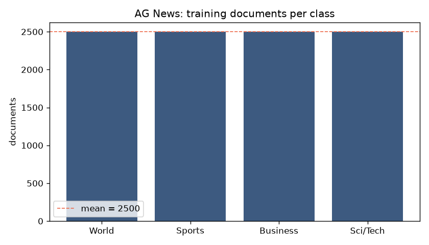{width=32%} 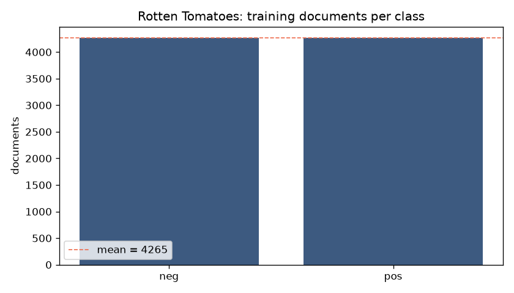{width=32%} 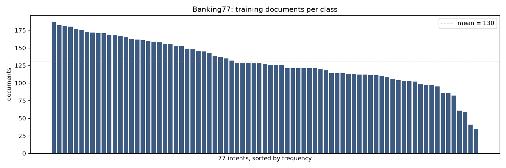{width=34%}

\begin{center}\small Figure: Class balance of the training sets (Banking77 ordered by frequency).\end{center}

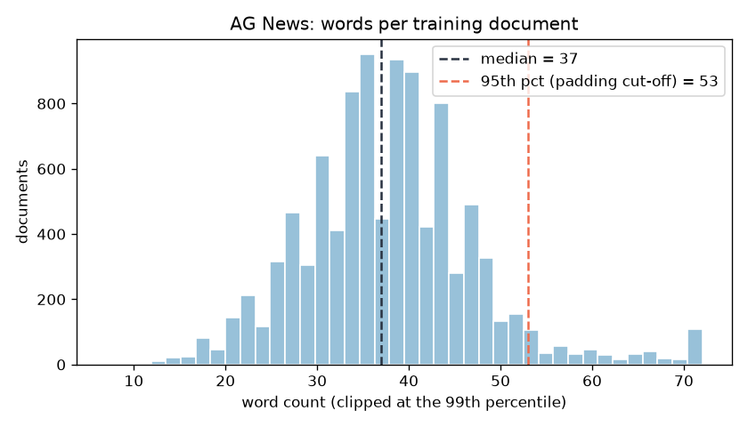{width=33%} 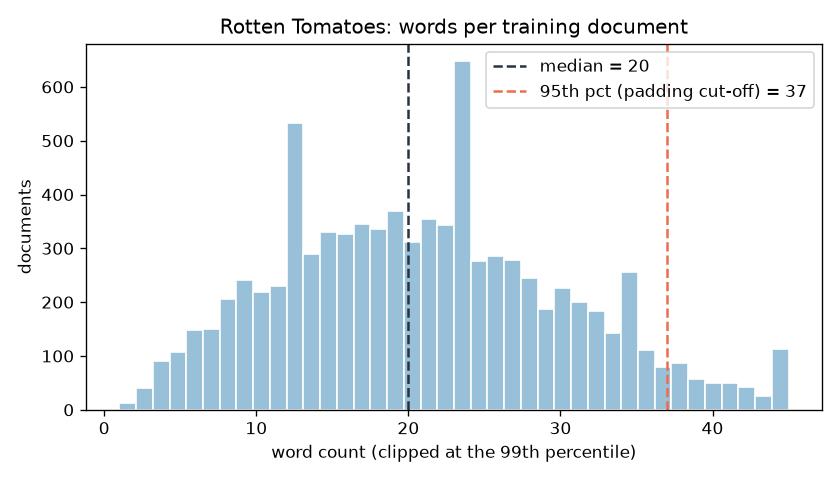{width=33%} 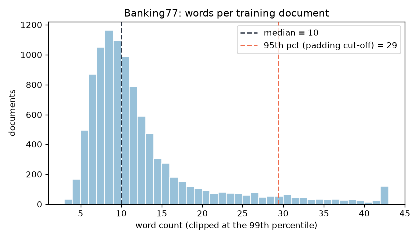{width=33%}

\begin{center}\small Figure: Document length distributions with median and 95th-percentile cut-offs used for padding.\end{center}

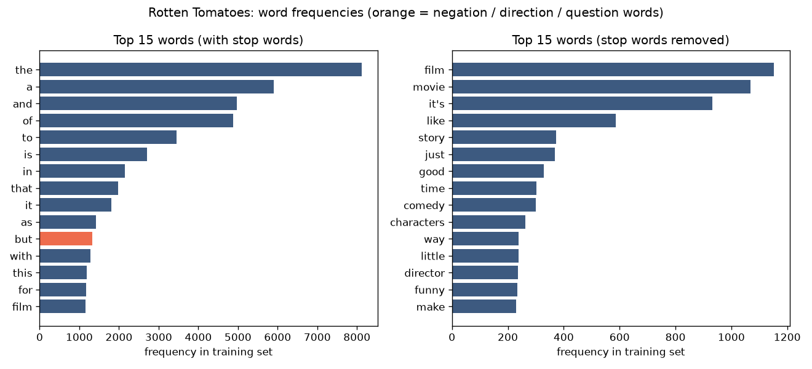{width=90%}

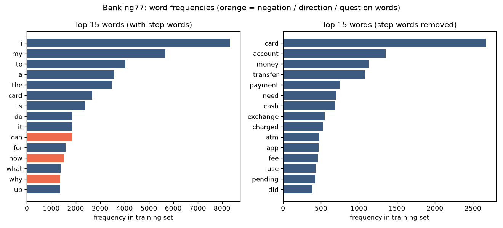{width=90%}

## Hypotheses derived from EDA

EDA is mandatory in the assignment because it informs design choices before training. From the statistics above we formulate testable hypotheses:

- **H1 (topic vs composition).** AG News topics are carried by content words; stop-word removal should be mild or helpful, and TF-IDF should approach Transformer performance.
- **H2 (function words matter).** On Rotten Tomatoes and Banking77, stop words comprise 47–61% of tokens and often encode polarity or intent (*not*, *from*, *into*, *how*, *why*). Removing them should degrade sparse and sentence-embedding models.
- **H3 (negation).** Negation is frequent on Rotten Tomatoes (21.6%) and Banking77 (25.5%). Models that ignore scope should underperform on negated documents; explicit negation marking should help static sequence models more than contextual encoders.
- **H4 (length and padding).** Short Banking77 queries (median 10 words) make truncation-to-10-tokens and unmasked padding particularly harmful for neural encoders; masked padding to the 95th percentile should improve Macro-F1 substantially.

These hypotheses are evaluated in the ablation and error analyses below.

# Methodology

## Overview of the traditional and bonus pipelines

Following the course description of machine learning pipelines, the implementation separates a **traditional path** (configurable preprocessing $\rightarrow$ feature extraction to disk $\rightarrow$ classical classifiers $\rightarrow$ evaluation) from a **bonus deep-learning path** (sequence or few-shot models that consume the same preprocessed text or frozen token states). The figure below summarises the architecture and the on-disk feature layout required by the assignment.

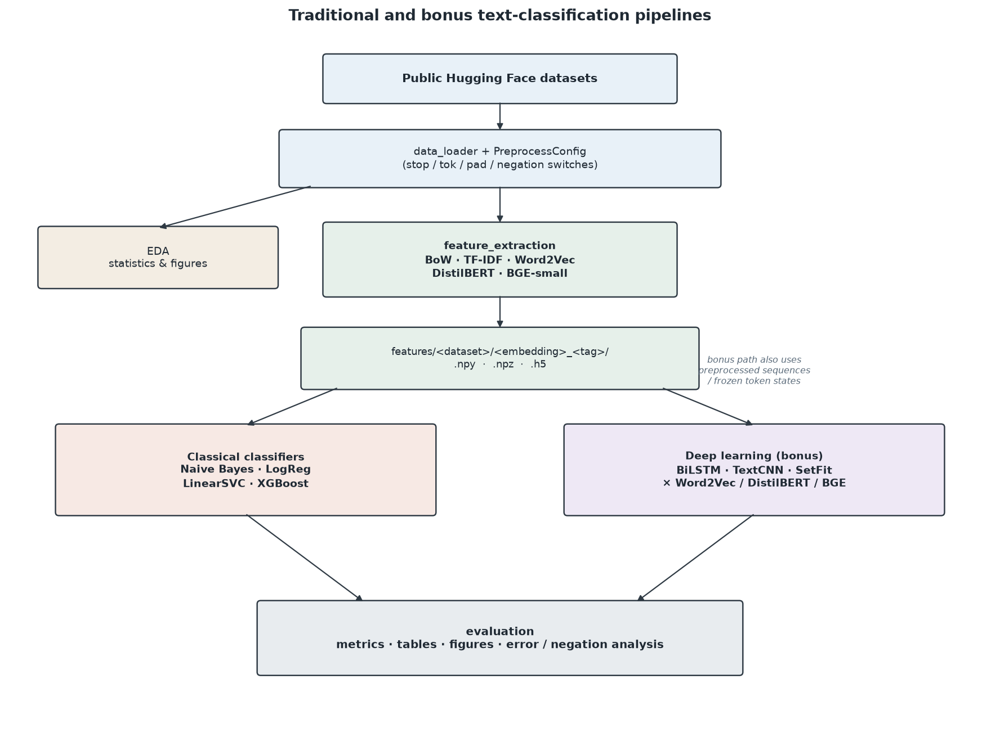{width=90%}

Configurations are encoded by dataclasses (`PreprocessConfig`, `ExperimentConfig`). Results are cached by dataset, preprocessing tag, and method so that ablation and main comparison share identical numbers. Random seeds are fixed to 42.

## Preprocessing

All text is lower-cased and stripped of HTML, URLs, and related artefacts; punctuation is retained for Transformer tokenizers. Four Boolean switches control the remainder:

| Switch | Off | On |
| ---------------- | ---------------------------------------- | -------------------------------------------- |
| `stop_word_removal` | retain all tokens | remove scikit-learn `ENGLISH_STOP_WORDS` (including *not*, *no*, *never*, *from*, *into*) |
| `tokenization` | whitespace unigrams / whole-word lookup | regex tokens + bigrams for BoW/TF-IDF; WordPiece for Transformers |
| `padding` | truncate to 10 tokens; no masking | pad/truncate to the 95th-percentile length with attention / packing masks |
| `negation_marking` | unchanged text | after a negation cue, prefix subsequent content tokens with `NEG_` until punctuation |

The default for the main comparison is `sw0_tok1_pad1_neg0`. Padding is not applicable to bag-of-words models.

## Feature extraction and persistence

| Key | Family | Representation | 30-d control projection |
| -------- | ---------- | ---------------------------------------------------- | ---------------------- |
| `bow` | traditional | `CountVectorizer` (max 25k features, min_df=2), uni+bigrams | TruncatedSVD(30) |
| `tfidf` | traditional | `TfidfVectorizer` (sublinear TF, same vocabulary constraints) | TruncatedSVD(30) |
| `word2vec` | static | skip-gram Word2Vec on the training split (300-d); mean-pooled documents | PCA(30) |
| `distilbert` | modern | frozen DistilBERT; masked mean pool (768-d) | PCA(30) |
| `bge_small` | modern | frozen BGE-small; CLS + L2 normalisation (384-d) | PCA(30) |

Vectorizers, Word2Vec, SVD, and PCA are fit on training data only. Each feature directory stores dense `.npy` or sparse `.npz` arrays, optional PCA-30 projections, labels, a consolidated `features.h5`, and `meta.json`, satisfying the assignment requirement to persist embeddings for reuse by classifiers.

## Classical classifiers

| Classifier | Sparse input | Dense input | Probabilities |
| ---------------- | ---------------------------------- | ------------------------ | -------------------------- |
| Naive Bayes | MultinomialNB ($\alpha=0.5$) | GaussianNB | native |
| Logistic regression | $C=2.0$, balanced, L-BFGS | StandardScaler + same | softmax |
| Linear SVM | LinearSVC ($C=1.0$, balanced) | L2 Normalizer + same | Platt scaling (3-fold) |
| XGBoost | hist booster, `multi:softprob` | same | softprob |

Dense SVM inputs are L2-normalised for stable convergence. XGBoost is executed in a subprocess to avoid backend conflicts with PyTorch on some platforms. PCA-30 + LogReg rows quantify information loss under aggressive dimensionality reduction.

## Bonus deep-learning models

The bonus component is a 3$\times$3 design:

- **Word2Vec + BiLSTM / TextCNN:** identical static embeddings; BiLSTM models long-range order; TextCNN detects local patterns with lower training cost.
- **Frozen DistilBERT / BGE token states + BiLSTM / TextCNN:** tests whether sequence heads improve upon mean/CLS pooling once contextual tokens are available.
- **SetFit:** native BGE contrastive few-shot adaptation (16 examples per class on AG News and Rotten Tomatoes; 8 on Banking77). DistilBERT and Word2Vec adapters complete the grid for API coverage but are not recommended as primary solutions.

## Evaluation protocol

Models train on the official (or subsampled) training split and are evaluated once on the held-out test split. We report accuracy, macro-averaged precision, recall, and F1, and calibration scores

$$\text{Brier} = \frac{1}{N}\sum_{i=1}^{N}\sum_{k=1}^{K}\left(p_{ik}-y_{ik}\right)^2, \qquad
\text{ECE} = \sum_{b=1}^{15}\frac{|B_b|}{N}\left|\mathrm{acc}(B_b)-\mathrm{conf}(B_b)\right|,$$

where $p_i$ is the predicted probability vector and $y_i$ is one-hot. Predictions are $\arg\max_k p_{ik}$. Wall-clock times are measured on an Apple M-series laptop. The full matrix comprises approximately 33 methods $\times$ 3 datasets (`master_comparison.csv`); the report tables present a cherry-picked contrast set for clarity (`master_comparison_cherry.csv`).

# Experimental results

## Main comparison

**Expectation.** Under H1, TF-IDF should nearly match Transformers on AG News. Under H2–H3, BGE and sequence models should outperform mean-pooled Word2Vec and, on composition-heavy tasks, lexical baselines.

All rows use `sw0_tok1_pad1_neg0`. Bold marks the best Macro-F1 within each table. The overall AG News optimum in the full matrix is BiLSTM (DistilBERT) at 90.39 Macro-F1.

### AG News (4 classes)

| Method | Acc | Macro-F1 | Brier | ECE | Train (s) |
| ------------------------------ | -----: | -------: | -----: | -----: | ------: |
| TF-IDF + MultinomialNB | 88.50 | 88.45 | 0.179 | 0.049 | 0.01 |
| TF-IDF + LinearSVC | 88.95 | 88.92 | 0.173 | 0.049 | 0.30 |
| Word2Vec + LinearSVC | 86.70 | 86.64 | 0.198 | 0.040 | 2.07 |
| DistilBERT + LinearSVC | 90.25 | 90.24 | 0.157 | 0.022 | 4.94 |
| BGE-small + LinearSVC | 89.55 | 89.52 | 0.164 | 0.024 | 2.25 |
| BGE-small + XGBoost | 90.20 | 90.19 | 0.164 | 0.039 | 53.33 |
| Word2Vec + BiLSTM | 87.65 | 87.69 | 0.187 | 0.028 | 91.15 |
| Word2Vec + TextCNN | 87.50 | 87.50 | 0.182 | 0.030 | 18.27 |
| TextCNN (BGE-small) | 89.80 | 89.77 | 0.160 | 0.025 | 15.54 |
| SetFit (16-shot, BGE-small) | 87.75 | 87.67 | 0.239 | 0.185 | 41.46 |

### Rotten Tomatoes (2 classes)

| Method | Acc | Macro-F1 | Brier | ECE | Train (s) |
| ------------------------------ | -----: | -------: | -----: | -----: | ------: |
| TF-IDF + MultinomialNB | 79.92 | 79.91 | 0.297 | 0.097 | 0.00 |
| TF-IDF + LinearSVC | 78.71 | 78.70 | 0.288 | 0.043 | 0.07 |
| Word2Vec + LinearSVC | 68.67 | 68.67 | 0.402 | 0.016 | 0.83 |
| DistilBERT + LinearSVC | 79.27 | 79.26 | 0.283 | 0.021 | 1.97 |
| BGE-small + LinearSVC | 83.11 | 83.11 | 0.245 | 0.036 | 0.79 |
| BGE-small + XGBoost | 83.77 | **83.77** | 0.257 | 0.070 | 27.82 |
| Word2Vec + BiLSTM | 75.23 | 75.21 | 0.324 | 0.076 | 54.61 |
| Word2Vec + TextCNN | 76.64 | 76.63 | 0.312 | 0.024 | 9.80 |
| TextCNN (BGE-small) | 83.49 | 83.49 | 0.249 | 0.047 | 13.38 |
| SetFit (16-shot, BGE-small) | 81.71 | 81.71 | 0.267 | 0.054 | 16.22 |

### Banking77 (77 classes)

| Method | Acc | Macro-F1 | Brier | ECE | Train (s) |
| ------------------------------ | -----: | -------: | -----: | -----: | ------: |
| TF-IDF + MultinomialNB | 82.35 | 81.54 | 0.440 | 0.386 | 0.02 |
| TF-IDF + LinearSVC | 89.17 | 89.18 | 0.181 | 0.127 | 1.26 |
| Word2Vec + LinearSVC | 74.61 | 74.43 | 0.440 | 0.250 | 20.36 |
| DistilBERT + LinearSVC | 85.99 | 85.97 | 0.240 | 0.157 | 50.30 |
| BGE-small + LinearSVC | 92.39 | **92.38** | 0.130 | 0.095 | 21.80 |
| BGE-small + XGBoost | 90.77 | 90.73 | 0.139 | 0.019 | 242.87 |
| Word2Vec + BiLSTM | 83.78 | 83.54 | 0.238 | 0.016 | 55.20 |
| Word2Vec + TextCNN | 87.48 | 87.46 | 0.189 | 0.038 | 16.15 |
| TextCNN (BGE-small) | 91.81 | 91.84 | 0.120 | 0.010 | 22.86 |
| SetFit (8-shot, BGE-small) | 81.57 | 80.77 | 0.756 | 0.661 | 78.19 |

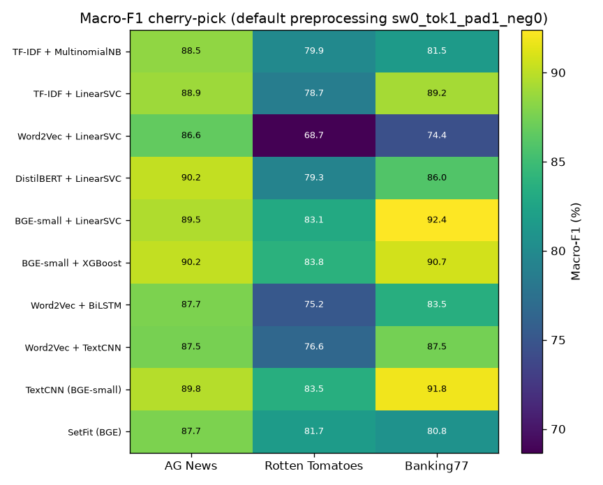{width=70%}

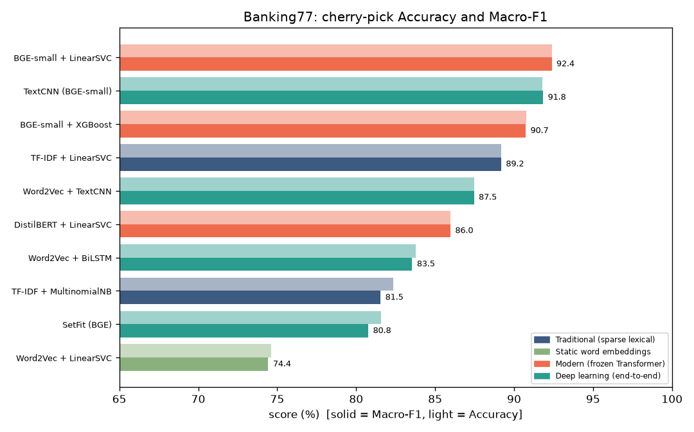{width=80%}

## Traditional versus modern approaches

| Dataset | Best traditional (sparse / static) | Best modern (frozen Transformer / head) | Gap (pp) | Strong bonus DL |
| -------------- | -------------------------- | -------------------------- | -------: | ------------------------ |
| AG News | TF-IDF + LinearSVC, 88.92 | BiLSTM (DistilBERT), 90.39 (DistilBERT + LinearSVC, 90.24) | +1.47 | SetFit 16-shot (BGE), 87.67 |
| Rotten Tomatoes | TF-IDF + MultinomialNB, 79.91 | BGE-small + XGBoost, 83.77 (BGE + LinearSVC, 83.11) | +3.86 | TextCNN (BGE), 83.49 |
| Banking77 | TF-IDF + LinearSVC, 89.18 | BGE-small + LinearSVC, 92.38 | +3.20 | TextCNN (BGE), 91.84 |

**Interpretation.** On AG News the gap is small: keyword-driven topics validate H1 and the efficiency of TF-IDF + LinearSVC (0.3~s training). On Rotten Tomatoes and Banking77, modern pipelines gain 3.2–3.9 Macro-F1 points. Mean-pooled Word2Vec + LinearSVC collapses on Rotten Tomatoes (68.67), confirming that bag averaging discards polarity composition. Critically, DistilBERT + LinearSVC does **not** beat TF-IDF on Rotten Tomatoes (79.26 vs 79.91) or Banking77 (85.97 vs 89.18); the modern advantage is attributable to contrastive BGE geometry rather than to “using a Transformer” alone.

## Preprocessing ablation

**Expectation.** H2 predicts large negative effects of stop-word removal on Rotten Tomatoes and Banking77; H3 predicts gains from negation marking for Word2Vec + BiLSTM; H4 predicts large gains from masked padding for neural models.

Each cell reports $\Delta$Macro-F1 $= \mathrm{F1}(\mathrm{flag}=\mathrm{True}) - \mathrm{F1}(\mathrm{flag}=\mathrm{False})$ in percentage points. Ablation models: TF-IDF + LogReg, BGE-small + LogReg, Word2Vec + BiLSTM.

| Dataset | Model | `stop_word_removal` | `tokenization` | `padding` | `negation_marking` |
| -------------- | -------------------------- | -----------------: | -------------: | ---------: | -----------------: |
| AG News | TF-IDF + LogReg | +0.55 | +1.30 | n/a | +0.20 |
| AG News | BGE-small + LogReg | +0.41 | +0.19 | +4.77 | +0.16 |
| AG News | Word2Vec + BiLSTM | +1.17 | -1.00 | +3.89 | +0.38 |
| Rotten Tomatoes | TF-IDF + LogReg | -2.16 | +0.56 | n/a | +0.66 |
| Rotten Tomatoes | BGE-small + LogReg | -5.16 | +4.78 | +10.62 | +0.38 |
| Rotten Tomatoes | Word2Vec + BiLSTM | +0.36 | -0.98 | +3.31 | **+2.33** |
| Banking77 | TF-IDF + LogReg | -4.05 | +1.42 | n/a | -0.04 |
| Banking77 | BGE-small + LogReg | -5.25 | +15.99 | +18.62 | -0.21 |
| Banking77 | Word2Vec + BiLSTM | +0.92 | +0.33 | +5.81 | **+2.46** |

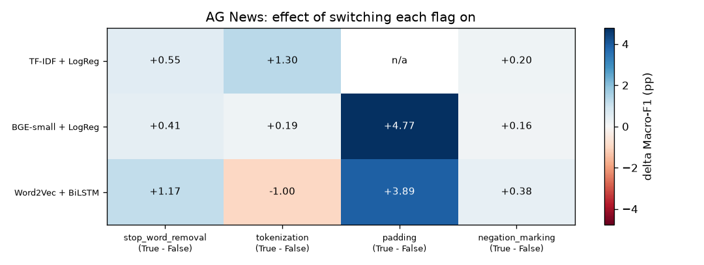{width=33%} 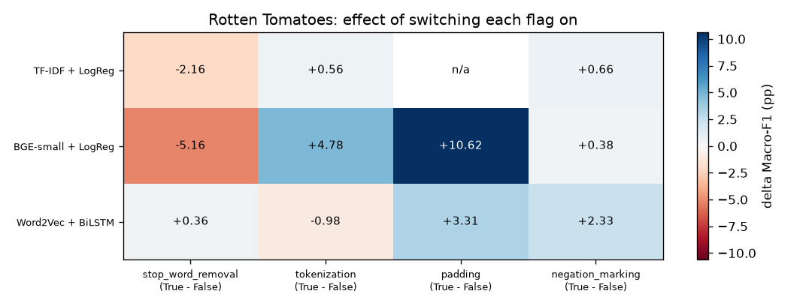{width=33%} 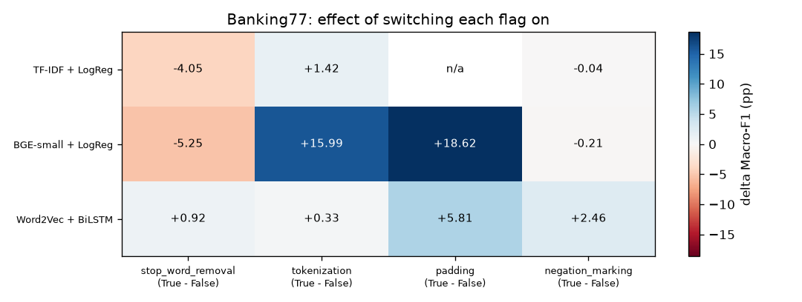{width=33%}

\begin{center}\small Figure: Preprocessing ablation heat maps (blue indicates that enabling the flag improves Macro-F1).\end{center}

**Findings.** Stop-word removal supports H2: mild gains on AG News, losses of 2–5 points for TF-IDF and BGE on Rotten Tomatoes / Banking77 (standard lists delete polarity and directional cues). Subword tokenization and masked padding are essential for BGE (up to +16.0 and +18.6 points on Banking77), supporting H4. Negation marking yields +2.33 / +2.46 Macro-F1 for Word2Vec + BiLSTM on Rotten Tomatoes / Banking77, with near-zero effect on frozen BGE + LogReg—consistent with H3 and with the idea that contextual encoders already encode local negation to some degree.

## Calibration

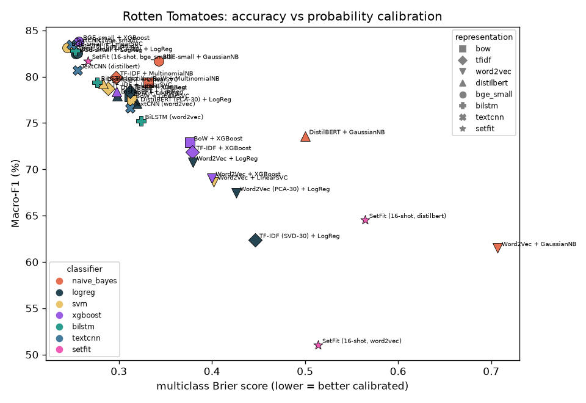{width=49%} 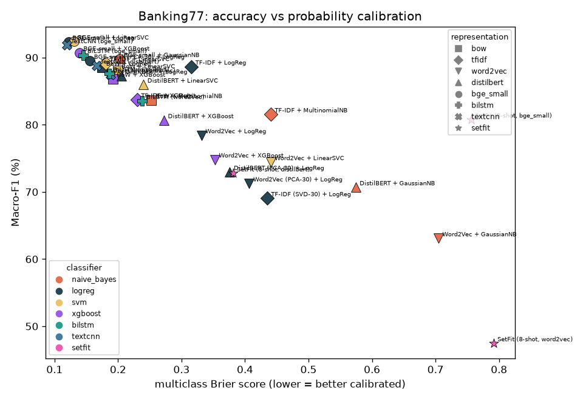{width=49%}

\begin{center}\small Figure: Macro-F1 versus Brier score on Rotten Tomatoes and Banking77.\end{center}

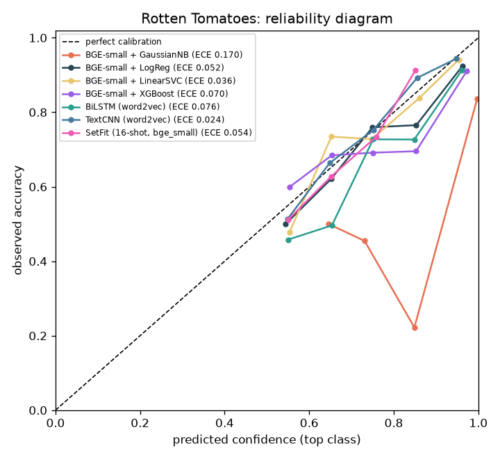{width=45%} 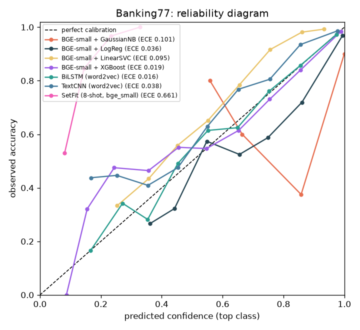{width=45%}

\begin{center}\small Figure: Reliability diagrams for selected models.\end{center}

**Expectation.** Independence-assuming Naive Bayes should be poorly calibrated on dense correlated features; few-shot heads on many classes should under- or mis-calibrate.

**Observation.** Gaussian Naive Bayes exhibits high ECE relative to logistic regression on the same embeddings. On Banking77, TF-IDF + MultinomialNB reaches ECE 0.386 at 81.5\% Macro-F1, whereas BGE-small + LogReg achieves Macro-F1 92.34 with Brier 0.122. SetFit (8-shot) on Banking77 is severely miscalibrated (ECE 0.661, Brier 0.756) despite moderate accuracy. Among cherry-picked rows, DistilBERT + LinearSVC on AG News (Brier 0.157, ECE 0.022), BGE + LinearSVC on Rotten Tomatoes (0.245 / 0.036), and TextCNN (BGE) on Banking77 (0.120 / 0.010) illustrate well-calibrated high-accuracy regimes. These results reinforce that course evaluation must separate discrimination from probability quality.

## Naive Bayes on sparse versus dense features

Multinomial Naive Bayes remains a strong, nearly free baseline on sparse TF-IDF (best traditional model on Rotten Tomatoes at 79.91 Macro-F1; within 0.5 points of LinearSVC on AG News). On Banking77 overlapping intents violate the independence/sparsity regime (81.54 vs 89.18 for LinearSVC). Gaussian Naive Bayes is more competitive on BGE than on DistilBERT, yet calibration remains poor—matching the theoretical warning about correlated dense coordinates.

## Masked-language versus contrastive embeddings

| Classifier | Embedding | AG News | Rotten Tomatoes | Banking77 |
| ------------ | ---------------------- | -----------: | ---------------: | -----------: |
| LinearSVC | DistilBERT (768-d) | 90.24 | 79.26 | 85.97 |
| LinearSVC | BGE-small (384-d) | 89.52 | 83.11 | 92.38 |
| XGBoost | BGE-small (384-d) | 90.19 | 83.77 | 90.73 |

BGE-small is smaller and faster to encode than DistilBERT, yet improves LinearSVC Macro-F1 by approximately 3.9 points on Rotten Tomatoes and 6.4 on Banking77. On AG News, DistilBERT + LinearSVC (and BiLSTM-DistilBERT) remain slightly ahead. This contrast isolates pretraining objective: MLM token reconstruction does not guarantee linear sentence separability for polarity and intent, whereas contrastive sentence training does.

## XGBoost versus linear heads

| Embedding | Head | AG News | Rotten Tomatoes | Banking77 |
| ------------ | ---------------------- | -----------: | ---------------: | -----------: |
| TF-IDF (sparse) | LinearSVC | 88.92 | 78.70 | 89.18 |
| BGE-small | LinearSVC | 89.52 | 83.11 | **92.38** |
| BGE-small | XGBoost | 90.19 | **83.77** | 90.73 |
| BGE-small | LogReg (384-d) | 87.23 | 82.46 | 92.34 |
| BGE-small | LogReg (PCA-30) | 89.00 | 82.55 | 89.51 |

On BGE embeddings, XGBoost achieves the best Rotten Tomatoes score (83.77) and is competitive on AG News, while LinearSVC remains preferable on Banking77 (92.38 vs 90.73) with substantially lower training time (about 22~s vs about 243~s). Sparse TF-IDF + XGBoost is an inefficient default in the full matrix. PCA-30 projection loses 2.8 Macro-F1 points for BGE LogReg on Banking77 (92.34 to 89.51), indicating that thirty linear directions are insufficient for 77 intents---an applied illustration of the bias--variance / capacity trade-off taught in dimensionality reduction.

## Bonus deep-learning pipeline

| Dataset | Word2Vec BiLSTM | Word2Vec TextCNN | TextCNN (BGE) | SetFit BGE (shots) | Best frozen / pool head |
| -------------- | --------------: | ---------------: | ------------: | -----------------: | ----------------------: |
| AG News | 87.69 | 87.50 | 89.77 | 87.67 (16) | 90.39 BiLSTM-DistilBERT / 90.24 Distil+SVC |
| Rotten Tomatoes | 75.21 | 76.63 | 83.49 | 81.71 (16) | 83.77 BGE+XGB / 83.11 BGE+SVC |
| Banking77 | 83.54 | 87.46 | 91.84 | 80.77 (8) | 92.38 BGE+SVC |

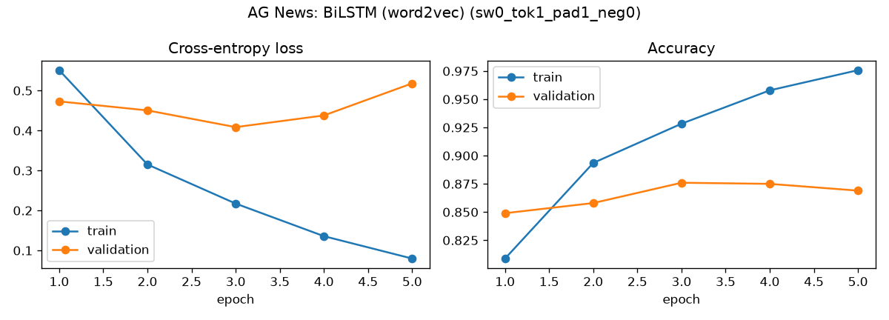{width=80%}

With matched Word2Vec embeddings, TextCNN is often slightly more accurate and markedly faster than BiLSTM (e.g. Banking77 87.46 vs 83.54), consistent with the strength of local $n$-gram detectors on short queries. DistilBERT-BiLSTM attains the suite’s best AG News Macro-F1 (90.39). BGE-TextCNN approaches BGE + LinearSVC on Rotten Tomatoes and Banking77, showing limited additional gain once contrastive pooling already yields linearly separable sentence vectors. SetFit (BGE) is effective in the few-shot regime on AG News / Rotten Tomatoes (87.67 / 81.71) but does not replace full-label BGE on 77 classes (80.77 vs 92.38). Overall, pretrained contrastive priors dominate from-scratch static embeddings at this data scale—an empirical restatement of transfer learning advantages discussed in class.

## Error and negation analysis

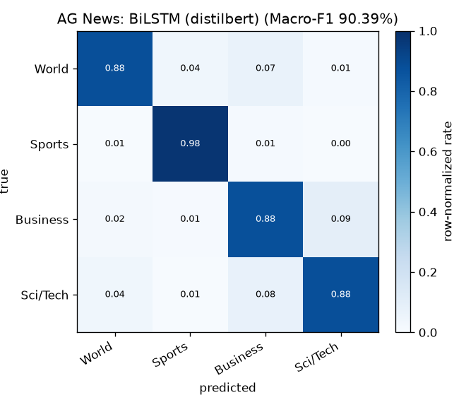{width=42%} 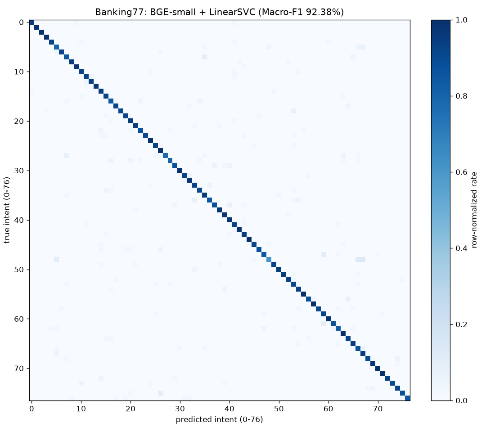{width=54%}

\begin{center}\small Figure: Confusion structure for strong models on AG News and Banking77.\end{center}

On AG News, residual errors concentrate on Business versus Sci/Tech and World versus Business/Sports—articles with genuine topical overlap. Rotten Tomatoes errors often require irony or world knowledge beyond a single polarity keyword. Banking77 confusions cluster in near-synonymous intent families (transfer timing and receipt; top-up failure states), where function words and negation encode transaction state.

| Rotten Tomatoes (254 with / 812 without negation) | Acc. with negation | Acc. without | Gap |
| -------------------------------------------- | -----------------: | ---------------: | ---------: |
| TF-IDF + MultinomialNB | 79.9 | 79.9 | -0.0 |
| TF-IDF + LinearSVC | 76.4 | 79.4 | -3.1 |
| DistilBERT + LinearSVC | 75.2 | 80.5 | -5.3 |
| BGE-small + LinearSVC | 79.9 | 84.1 | -4.2 |
| BGE-small + XGBoost | 81.1 | 84.6 | -3.5 |
| Word2Vec + BiLSTM | 73.2 | 75.9 | -2.6 |
| TextCNN (BGE-small) | 80.3 | 84.5 | -4.2 |
| SetFit (16-shot, BGE-small) | 76.0 | 83.5 | -7.5 |

Negated sentences remain harder for nearly all models. BGE-based systems retain higher absolute accuracy on negated text than sparse or Word2Vec-only pipelines, yet still lose several points relative to non-negated text. Combined with the ablation gains of `negation_marking` for Word2Vec + BiLSTM, this supports H3: negation is a structural difficulty that lightweight scope marking can partially mitigate for static sequence models.

# Discussion

## Advantages and limitations by method family

| Approach | Advantages | Limitations |
| -------------------- | ---------------------------------------- | ---------------------------------------- |
| BoW / TF-IDF + linear model | Near state-of-the-art on topics; fast; interpretable; bigrams help | Weaker on compositional sentiment; sensitive to stop-word removal; collapses under aggressive SVD |
| Multinomial NB | Strong sparse baseline; millisecond training | Weak on 77 overlapping intents; poor calibration (ECE 0.39 on TF-IDF Banking77) |
| Word2Vec (mean-pool) | Inexpensive dense baseline; reusable for sequence models | Loses order; weak on Rotten Tomatoes / Banking77 under linear heads |
| Logistic regression / LinearSVC | Robust discrimination; Platt-calibrated SVM probabilities | Fixed regularisation; SVM slower on high-dimensional dense $\times$ many classes |
| XGBoost on BGE | Best Rotten Tomatoes Macro-F1; competitive AG News | Expensive on Banking77; sparse TF-IDF trees inefficient |
| Frozen DistilBERT (MLM) | Strong AG News linear / BiLSTM results | No gain over TF-IDF on RT / Banking77 under LinearSVC |
| Frozen BGE-small | Best Banking77; strong sentiment; compact | Requires proper subword tokenization and padding |
| Word2Vec BiLSTM / TextCNN | Fair static sequence comparison; TextCNN often faster | Trails pretrained BGE on hard tasks |
| SetFit (BGE) | Strong few-shot on 2–4 classes | Insufficient for 77 intents at 8 shots; poor ECE |

## Learning outcomes relative to course concepts

The experiments confirm several textbook predictions and qualify others. The Naive Bayes independence assumption remains useful for sparse lexical features but fails as a probability model on dense embeddings. Margin-based linear classifiers excel when representation geometry is already informative (BGE). Dimensionality reduction (PCA-30) preserves performance on coarse tasks yet loses capacity for 77-way intent separation. Transfer learning via contrastive sentence embeddings outperforms training static Word2Vec sequence models from limited labelled text. Finally, evaluation must include calibration: models with similar Macro-F1 can differ dramatically in ECE (e.g. SetFit on Banking77 versus BGE + LogReg).

These observations demonstrate that selecting a “modern” method is not intrinsically superior; the match between task structure, feature inductive bias, and classifier assumptions determines performance—precisely the analytical skill the assignment seeks to develop.

# Conclusions

1. **Task regime governs representation choice.** On AG News, TF-IDF + LinearSVC lies within about 1.5 Macro-F1 of the best Transformer pipeline. On Rotten Tomatoes and Banking77, BGE-based systems lead (83.77 with BGE + XGBoost; 92.38 with BGE + LinearSVC). Frozen DistilBERT without sentence-level pretraining does not improve over TF-IDF on the harder tasks under a linear head.
2. **Preprocessing is representation- and task-dependent.** Stop-word removal harms sentiment and intent. Subword tokenization and masked padding are critical for pretrained encoders. Negation marking improves Word2Vec + BiLSTM by +2.3 / +2.5 Macro-F1 on Rotten Tomatoes / Banking77.
3. **Bonus deep models occupy complementary niches.** TextCNN often edges BiLSTM under matched Word2Vec embeddings; BGE-TextCNN approaches BGE + SVM on RT / B77; SetFit is effective few-shot on AG / RT but not a substitute for full-label BGE on 77 classes. Pretrained contrastive priors dominate from-scratch static embeddings at this scale.
4. **Calibration and head choice are distinct from accuracy.** SetFit Banking77 ECE 0.66 versus BGE + LogReg Brier 0.122 illustrates the range. On BGE, XGBoost wins binary sentiment while LinearSVC remains preferable for Banking77 on both Macro-F1 and training cost.

**Limitations and future work.** Results use a single seed and fixed hyperparameters; gaps below one Macro-F1 point should be interpreted cautiously. The `padding=False` condition jointly disables length and masking. End-to-end fine-tuning of DistilBERT / BGE on full labels, and SetFit with larger shot budgets on Banking77, would extend the deep-learning comparison.

# Work distribution

Individual grade $=$ group grade $\times$ contribution percentage. Both members participated in design meetings, code review, and report writing; the table lists primary ownership.

| Member | Primary responsibilities | Contribution |
| ------------------------ | ---------------------------------------------------------------- | -----------: |
| [Member 1 full name] ([Student ID]) | Dataset selection and loading; Boolean preprocessing including negation marking; EDA; BoW / TF-IDF features; Naive Bayes, logistic regression, and calibrated SVM; preprocessing ablation; error and negation analysis; README / repository hygiene; report sections on EDA, classical methods, and ablation | 50\% |
| [Member 2 full name] ([Student ID]) | DistilBERT, BGE-small, and Word2Vec feature extraction with `.npy` / `.h5` persistence; XGBoost classifiers; bonus BiLSTM / TextCNN / SetFit 3$\times$3; evaluation suite and figures; Colab notebook; report sections on embeddings, deep learning, discussion, and conclusions | 50\% |

Collaboration evidence (meeting notes, screenshots) is archived under `reports/evidence/`.

# Reproducibility and deliverables

This submission follows Section~5 of the course assignment. The required directory layout is:

```
notebooks/     Colab front end (Runtime -> Run all)
modules/       supporting Python package imported by the notebook
reports/       PDF report, CSV tables, figures, collaboration evidence/
features/      extracted embeddings (.npy / .npz / .h5)
```

Additional details:

- **Colab front-end.** `notebooks/text_classification_colab.ipynb` runs without mounting personal drives; data are fetched from public Hugging Face links; dependencies install inside the notebook.
- **Modules.** Code in `modules/` is imported by the notebook and by `main.py`.
- **PDF report.** The present document (EDA, pipeline design, experiments, comparisons, analysis, work distribution).
- **Feature artefacts.** `features/<dataset>/<embedding>_<tag>/` with `.npy`, `.npz`, `.h5`, and `meta.json`.
- **Tables and figures.** `master_comparison.csv`, `master_comparison_cherry.csv`, `master_f1_pivot.csv`, `master_f1_pivot_cherry.csv`, `master_ablation.csv`, `eda_summary.csv`, `errors_*.csv`, `negation_*.csv`; figures under `reports/figures/` (including `pipeline_overview.png`). Helpers: `python scripts/plot_cherry_pick.py`, `python scripts/plot_pipeline_figure.py`.
- **Command line.** `python main.py --dataset all` (full suite; first run may take hours with caching thereafter); `python main.py --quick` for a smoke test.
- **Optional.** `scripts/` (plot helpers), `docs/` (course assignment PDF / planning notes), `requirements.txt`, repository `README.md`.
- **Software.** Python 3.x, PyTorch, scikit-learn, transformers, sentence-transformers, SetFit, xgboost, NumPy Word2Vec training path.
- **GitHub (encouraged).** Course metadata, member details, execution guide, and links to the report and Colab should appear in the repository README.

# References

1. X. Zhang, J. Zhao, Y. LeCun. *Character-level Convolutional Networks for Text Classification.* NeurIPS 2015 (AG News).
2. B. Pang, L. Lee. *Seeing stars: Exploiting class relationships for sentiment categorization with respect to rating scales.* ACL 2005 (Rotten Tomatoes).
3. I. Casanueva, T. Temcinas, D. Gerz, M. Henderson, I. Vulic. *Efficient Intent Detection with Dual Sentence Encoders.* NLP4ConvAI 2020 (Banking77).
4. T. Mikolov, K. Chen, G. Corrado, J. Dean. *Efficient Estimation of Word Representations in Vector Space* (Word2Vec). 2013.
5. V. Sanh, L. Debut, J. Chaumond, T. Wolf. *DistilBERT, a distilled version of BERT: smaller, faster, cheaper and lighter.* 2019.
6. S. Xiao, Z. Liu, P. Zhang, N. Muennighoff. *C-Pack: Packaged Resources To Advance General Chinese Embedding* (BGE). 2023.
7. T. Chen, C. Guestrin. *XGBoost: A Scalable Tree Boosting System.* KDD 2016.
8. Y. Kim. *Convolutional Neural Networks for Sentence Classification.* EMNLP 2014 (TextCNN).
9. L. Tunstall et al. *Efficient Few-Shot Learning Without Prompts* (SetFit). 2022.
10. C. Guo, G. Pleiss, Y. Sun, K. Q. Weinberger. *On Calibration of Modern Neural Networks.* ICML 2017.
11. G. W. Brier. *Verification of forecasts expressed in terms of probability.* Monthly Weather Review, 1950.
12. J. Platt. *Probabilistic Outputs for Support Vector Machines and Comparisons to Regularized Likelihood Methods.* 1999.
13. S. Raschka. *Language Models for Text Classification: From Bag-of-Words to ...* Ahead of AI magazine (overview of text classifiers and calibration).
